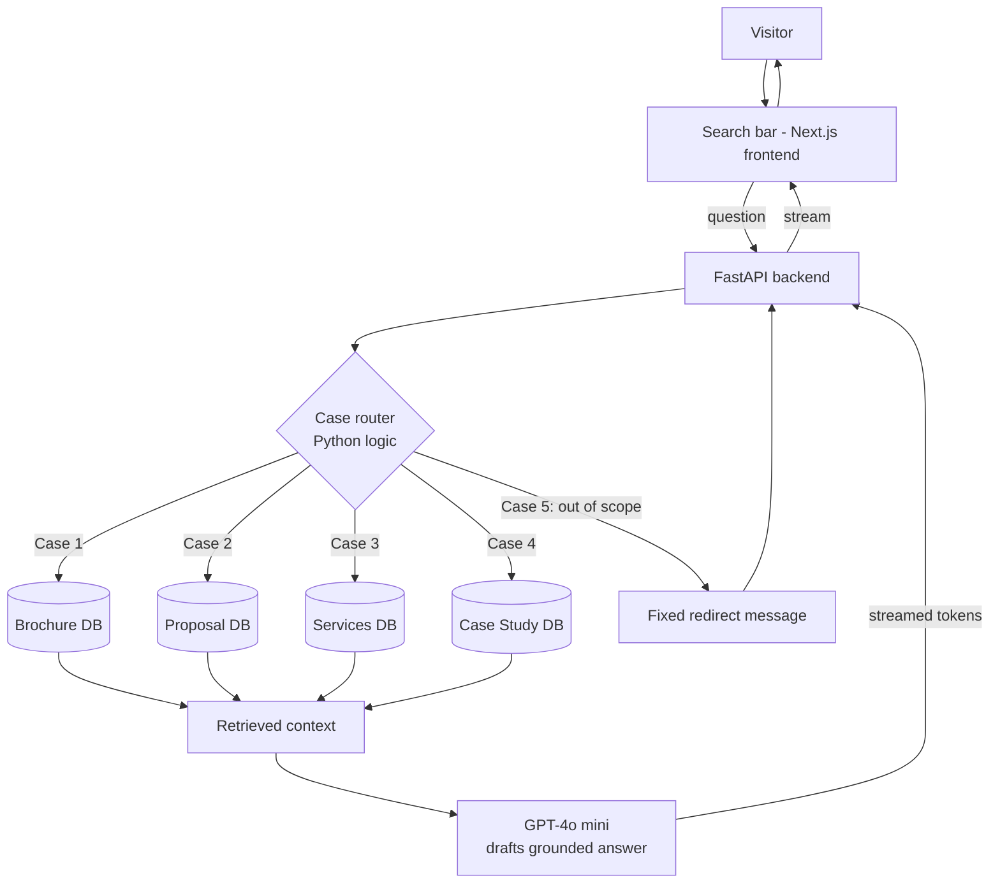

# RAG Chatbot Integrated into a Company Website — Architecture Overview

## 1. Summary

A lightweight, read-only Retrieval-Augmented Generation (RAG) assistant embedded in a company's marketing website. Visitors ask questions in a search bar and receive a streamed, AI-generated answer grounded in the company's own documents (brochures, proposals, service descriptions, and case studies). Visitors can then expand the answer into a one-on-one chat to ask follow-up questions.

The system is deliberately narrow in scope: it answers questions about the company's offerings and politely declines everything else.

**Key characteristics**

| Aspect | Detail |
|---|---|
| Type | Lightweight, domain-restricted RAG assistant |
| Interface | Search bar on the website (not a floating chat icon) |
| LLM | OpenAI GPT-4o mini |
| Knowledge base | 4 vector databases, one per content category |
| Routing | Rule-based case selection in the backend, *before* the LLM is called |
| Frontend | Next.js |
| Backend | Python, FastAPI |
| Response delivery | Streaming |
| Memory | Session-only; no persistent chat history |
| Capabilities | Read-only, non-agentic |

## 2. Goals and Non-Goals

**Goals**
- Let visitors quickly find accurate information about the company's offerings.
- Ground every answer in approved company content rather than the model's general knowledge.
- Keep conversations on-topic and prevent general chit-chat.
- Stay cheap, fast, and simple to maintain.

**Non-goals**
- Performing actions (no file downloads, calls, form submissions, or bookings).
- Voice input or output.
- Long-term memory or user accounts.
- Open-domain conversation.

## 3. High-Level Architecture

## 4. Components

### 4.1 Frontend (Next.js)
- Built into the company's existing Next.js marketing site.
- Entry point is a **search bar**, similar to a search engine, rather than a conventional chatbot bubble.
- Submitting a query displays a streamed AI answer directly beneath the bar (comparable to the AI overview shown by search engines).
- The visitor can open this answer into a **one-on-one chat view** to continue the conversation. The conversation lives in the browser for the life of the tab and is discarded when the tab is closed.
- Consumes the backend's streaming response and renders tokens as they arrive.

### 4.2 Backend (FastAPI)
- Single Python service that exposes the chat endpoint to the frontend.
- Responsible for three things:
  1. **Case decision** — classify the incoming question into one of five cases.
  2. **Retrieval** — query the vector database that belongs to that case.
  3. **Generation** — pass the question plus retrieved context to the LLM and stream the answer back.

### 4.3 Case Router
The routing decision is made in **application code, before any LLM call**. The LLM is not responsible for choosing where to look; it only writes the reply from whatever context the router selected. This keeps retrieval predictable, cheaper, and easier to debug.

| Case | Scope | Knowledge source |
|---|---|---|
| 1 | Brochure content | Brochure vector DB |
| 2 | Proposals | Proposal vector DB |
| 3 | Services | Services vector DB |
| 4 | Case studies | Case study vector DB |
| 5 | Anything else (out of scope) | None |

**Case 5 (guardrail).** If a question does not fall into cases 1–4, no retrieval or generation is attempted. The assistant returns a fixed message along the lines of: *"I am here to assist you with brochures, proposals, services, and case studies."* This prevents chit-chat, off-topic use, and unnecessary model spend.

### 4.4 Vector Databases (x4)
- One vector store per content category, so each case retrieves from a focused, homogeneous corpus.
- Source documents are chunked, embedded, and indexed ahead of time (offline ingestion).
- At query time, the backend embeds the question and fetches the top-k most similar chunks from the selected database only.
- Separating the stores improves precision (a services question is never answered from a proposal chunk) and keeps each index small and fast.

### 4.5 LLM Layer (GPT-4o mini)
- Receives a prompt containing: instructions (answer only from provided context, stay on-topic), the retrieved chunks, and the user's question.
- Used purely as a **writer**: it drafts a natural-language answer from the retrieved context. It does not route, call tools, or take actions.
- GPT-4o mini was chosen for its low latency and low cost, which suit a public-facing, high-traffic website feature.
- Output is **streamed** so the visitor sees the answer begin immediately.

## 5. Request Flow

1. Visitor types a question into the search bar.
2. Next.js sends the question to the FastAPI backend.
3. The backend's router assigns the question to one of the five cases.
4. **Cases 1–4:** the backend embeds the question, retrieves the top-k chunks from that case's vector DB, and builds the prompt.
   **Case 5:** the backend skips retrieval and returns the fixed redirect message.
5. The LLM drafts a grounded answer from the retrieved context.
6. The answer is streamed through the backend to the frontend and rendered live.
7. If the visitor continues in the chat view, steps 2–6 repeat for each follow-up, with the on-screen conversation available as context for the tab's lifetime.

## 6. Conversation and Memory Model

- **No persistent history.** Nothing is stored server-side between sessions, and there are no user accounts.
- **Session-scoped follow-ups.** Within an open tab, the visitor can continue the conversation and ask follow-up questions that build logically on earlier answers.
- **Reset on close.** Closing the tab ends the conversation entirely.

This design keeps the system stateless on the backend, simplifies privacy, and avoids the cost of storing and managing conversation data.

## 7. Scope and Safety Boundaries

- **Read-only.** The assistant only reads and explains content. It cannot modify data.
- **Not agentic.** No tool use, function calling, or autonomous multi-step behavior.
- **No side effects.** It does not download files, place calls, send messages, or trigger workflows.
- **Text only.** No voice input or output.
- **Topic-restricted.** Questions beyond the four content categories receive the Case 5 redirect, and the LLM is instructed to answer only from retrieved context.

## 8. Design Rationale

| Decision | Why |
|---|---|
| Router in code, not in the LLM | Deterministic, cheap, fast, and easy to test; avoids an extra model call |
| One vector DB per category | Higher retrieval precision and smaller, simpler indexes |
| Fixed fallback message | Strong guardrail against off-topic use, at zero model cost |
| Small, fast model (GPT-4o mini) | Low latency and cost for a public website |
| Streaming responses | Better perceived speed; answers appear immediately |
| Search-bar UX | Familiar to visitors; feels like part of the site rather than a bolt-on widget |
| Session-only memory | Enables natural follow-ups without storing user data |

## 9. Possible Extensions (Not Implemented)

- Persistent conversation history for returning visitors.
- Embedding-based or LLM-assisted routing for ambiguous questions.
- Source citations shown alongside answers.
- Multilingual support.
- Analytics on common questions and unanswered (Case 5) queries.
- Agentic capabilities such as scheduling a consultation or sending a brochure.
